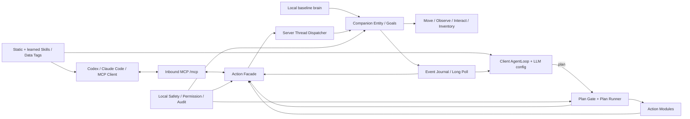

# TouhouLittleMaidMini 技术方案

版本：`0.1-design`  
首发平台：Minecraft `26.3`、Fabric Loader `0.20.1`、Fabric API `0.165.2+26.3`、
Java `25`。NeoForge `26.3.0.101` 保留为后续适配基线。

## 0. 参考仓库与借鉴边界

本项目当前只把下面两个公开仓库作为设计参考，不把它们直接变成首版运行时依赖：

| 仓库 | 固定参考点 | 借鉴内容 | 明确不继承 |
|---|---|---|---|
| [TouhouLittleMaid](https://github.com/TartaricAcid/TouhouLittleMaid) | `1.20` 分支；调研点：`AIConfig`、`LLMOpenAISite`、`MaidAIChatManager`、`MaidBrain` 与 `entity/ai/brain/task` | 基础脑的任务分层；OpenAI 兼容站点需要的 base URL、secretKey、model 字段；由实体事件主动发起模型请求 | 不 fork；不依赖 TLM 内部类；不复制模型、声音、贴图或 1500+ 类任务体系 |
| [TouhouLittleMaid-26.1](https://github.com/TouhouLittleMaid/TouhouLittleMaid-26.1) | `master`；在实现前记录实际审阅 commit | 女仆同伴的产品形态、实体/装备/管理界面需要解决的问题，以及跨版本适配的复杂度 | 不 fork；不依赖 TLM 内部类；不复制模型、声音、贴图或任务体系 |
| [minecraft-numen](https://github.com/Dwinovo/minecraft-numen) | `v0.1.5-26.3-beta`（commit `1abb37e`）；M0 时复核发布状态和实际依赖 | 外部大脑驾驶、纯 JVM MCP/权限边界、事件与长等待、插件/Skill 的扩展思路 | 不引入内置 LLM、Lua/任意脚本、Numen 假玩家身体或其完整模组架构 |

许可证边界也按仓库分别处理：TLM 仓库标注为 MIT；Numen 源码标注为 LGPL-3.0，
其美术资源另有权利声明。只有在 M0 证明确实需要 vendor Numen 的纯 JVM 模块时，才
引入对应源码和 NOTICE；不能把参考仓库中的资源默认视为本项目资产。

## 1. 结论

项目采用**Fabric 首发的独立轻量同伴模组 + 确定性本地基础脑 + 双模型脑（外部 MCP Agent 与游戏内可选直连模型）+ Skill/数据驱动的扩展方式**。

它不以“减少 TLM 的代码行数”为终点，而是分层：确定性基础能力留在 Java，模型只处理
未知场景。TouhouLittleMaid 倾向于为每种工作增加 Task、Behavior、GUI 和专用逻辑；本
项目保留少量可复用基础行为，其余由外部 Agent 或直连模型使用少量稳定动作、上下文和
Skill 组合完成。只有实时控制、安全、权限、持久化以及无法泛化的游戏交互留在 Java。

选择依据：

- TouhouLittleMaid `26.1` 仓库约有 1,500 个 Java 源文件，包含完整的实体、Brain、
  Task、模型包、GUI、网络、语音和内置 LLM。直接 fork 后再移植到 `26.3` 不符合
  “精简版”目标；我们只借鉴其任务分层和 `AIConfig`/`LLMOpenAISite` 的最小配置面。
- TLM 当前公开主线仍是 `26.1.2`，没有可依赖的 `26.3` 版本。
- Numen 已有 `v0.1.5-26.3-beta` 预发行标签，并提供了不认识同伴和游戏的纯 JVM
  MCP 模块；README 的支持版本表与 Release 页面需要在 M0 一并核对，不能直接把
  Release 标签当成稳定制品。
- Fabric 26.3 已有可用的 Numen 构建基线，先复用其纯 JVM MCP 边界和加载器接缝经验；
  NeoForge 适配等 Fabric 的动作、权限和事件契约稳定后再实施。
- 自定义 Mob 更接近 TLM 的女仆形态，但会牺牲 Numen `ServerPlayer` 的通用玩家能力。
  首版明确选择“可由 AI 组合的轻量身体”，不承诺成为万能玩家。

## 2. 目标与非目标

### 2.1 目标

- 一名可召唤、可保存、可配置管理的同伴实体。
- 跟随、驻守、守卫和收割四类本地基础行为；无需模型即可工作。
- 外部 Agent CLI 能查询状态、组合移动/观察/交互/背包动作并接收事件。
- 玩家可在自己的客户端配置 OpenAI 兼容的 base URL、model name 与 API Key；模型调用只在客户端发生。
- 模型通过"动作模块序列 + 参数"的计划扩展未知作物、模组材料、建造步骤与交互顺序；计划经服务端校验后执行。
- 农作、钓鱼、整理箱子等流程优先由 Skill + 动作模块完成，不为每种玩法新增 Java Task。
- 遵守原版交互语义的新模组内容优先通过标签、ID、数据和 Skill 适配。
- Agent 断开或客户端退出后同伴自行进入安全状态。
- MCP 端点在专用服默认关闭，默认只监听回环地址。
- 工具调用、操作状态和错误均可测试、可审计。

### 2.2 非目标

- 不内置第三方模型 SDK、STT 或 TTS；直连模型使用最小 Java HTTP 客户端。
- 不在日志、聊天、审计或仓库中记录 API Key；**Key 只保存在发起请求的客户端**，服务端不保存、不读取、不转发。
- 不通过模型训练改变权重；“学习”仅指生成可审阅的 Skill/计划模板。
- 不接受模型提交代码：不实现 Lua、JavaScript、动态加载或其他宿主级执行；模型只能提交白名单模块的有序计划。
- 不允许模型改写世界规则：模型对模组内容只产出封闭枚举内的语义分类（crop / food / station / hostile……），不写注册表、不改真实标签、不提供数值；分类以可回滚的知识文件存在，全量生效前必须通过校验。
- 不暴露 `/op`、`/execute`、`/setblock` 等通用命令入口。
- 无模型时不实现挖矿、搭建复杂建筑、交互任意模组 GUI；配置模型后仅允许通过已注册模块尝试简单建造与可观察交互，复杂 GUI 仍需 L3 bridge。
- 不直接复制 TLM 的模型、声音或贴图资源。

## 3. 总体架构



### 3.1 模块

| 模块 | 职责 | 是否依赖 Minecraft |
|---|---|---|
| `tlm-mini-core` | 通用动作、计划模型、操作状态、事件模型、配置模型 | 否 |
| `tlm-mini-mcp` | 把 core 映射为 MCP 工具和长轮询事件 | 否 |
| `tlm-mini-llm` | OpenAI 兼容 HTTP 客户端、计划响应解析、Skill 提案校验 | 否 |
| `tlm-mini-fabric` | Fabric 入口、实体、Brain、动作模块、计划执行器、注册、持久化和网络 | 是 |
| `tlm-mini-neoforge` | Fabric 稳定后的 Neoforge 适配层 | 是 |
| `tlm-mini-client` | 渲染、声音、管理界面、客户端模型循环与计划提交 | 是 |

为减少首版复杂度，可以先用一个 Gradle 项目承载，但包边界必须按上表保留。首版
验收目标和 `0.1.0-beta` 发布物只要求 Fabric；纯 Java
的动作与 MCP 模型不得 import Minecraft 类型。

### 3.2 MCP 实现策略

优先评估 Numen `v0.1.5-26.3-beta` 中与目标版本匹配的 `mcp` 纯 JVM 模块：

- 纯 JVM，不依赖 Minecraft。
- 提供 Streamable HTTP、Bearer Token、限流、会话和审计。
- `McpHost` 只要求宿主提供工具表和文本结果，适合接自定义同伴实体。

阶段 0 必须记录上游标签、commit、实际 Maven 坐标和许可证文件，并验证制品是否能从
公开 Maven 获取。若制品不能稳定获取，就固定已审阅的 `v0.1.5-26.3-beta` 纯 JVM
模块并 vendor 到本项目，保留 LGPL 声明，不把 Numen 的 Minecraft 适配层带入；也可以
改为自研本项目所需的最小协议层。若上游接口与本项目的动作、权限或审计边界不一致，
以本项目的 `core` 和 MCP 契约为准。

### 3.3 模块化计划

- 模型只提交**计划**（有序模块调用 + 参数 + 有界条件），不提交代码；因此不存在解释器、
  沙箱逃逸或死循环，计划可在执行前完整校验步数、成本与风险。
- 模块由 Java 预制，声明参数 schema、风险等级、预估成本与可读失败码，全部走
  Action、Permission、Audit 的唯一入口。
- 客户端负责模型调用、密钥与本机 UI；服务端负责权威校验与执行，只收发计划与裁剪后的观察。
- 外部 MCP Agent 仍使用工具调用；它与客户端计划最终落到同一套动作入口。
- 完整规格、模块清单、计划 schema 与里程碑见
  [`docs/10-autonomy-and-scripting.md`](10-autonomy-and-scripting.md)。

## 4. 同伴身体

### 4.1 实体

同伴使用 `TamableAnimal` 或 `PathfinderMob` 路线，使用原版 `Brain` 管理必须实时执行的
本地行为：

- 跟随主人。
- 待命和返回家。
- 守卫主人与自卫；在 work radius 内主动攻击威胁主人的怪物。
- 按 `minecraft:crops` 标签与方块 `age` 属性收割成熟作物并用匹配种子补种。
- 饥饿进食。
- 危险方块、坠落、窒息等安全反射。
- 长距离移动的分段寻路。

同伴不是 `ServerPlayer`。该选择意味着：

- 客户端必须安装本模组以渲染自定义实体。
- 玩家的“在线人数 / 权限 / 保护插件”不会把同伴当成玩家。
- 需要 `Player` 参数的放置、使用与合成 API，使用一个**不注册进玩家列表**的
  `ServerPlayer` 上下文代理（不 join、不进 TAB、不加载区块）；同伴仍是唯一可见身体。
- 不提供无界挖掘/建造；可做的范围由模块白名单与保护区决定。
- 可以低成本实现 TLM 风格模型、动画、装备和叫声。

### 4.2 状态机

```text
DORMANT -> SPAWNING -> IDLE <-> ACTIVE
                         |        |
                         v        v
                      BLOCKED   RECOVERING
                         |
                         v
                        DEAD
```

- `IDLE`：本地 Brain 可跟随、待命或自卫。
- `ACTIVE`：执行一个已受理的移动、交互、背包动作或外部计划中的下一步。
- `BLOCKED`：等待主人授权、物品或环境条件。
- `RECOVERING`：失败后返回安全位置，或把控制权交回 Agent。
- `DEAD`：停止外部操作；重生策略由配置决定。

同一时刻只允许一个身体动作。短查询可并行，世界修改动作严格串行。

## 5. 能力边界

### 5.1 Java 本地行为

| 行为 | 为什么必须留在 Java |
|---|---|
| `follow` | 每 tick 读取主人状态，持续寻路和保持安全距离 |
| `stay` | 持续处理工作点、意外受击和返回安全位置 |
| `guard` | 即时识别威胁、检查攻击白名单和自卫 |
| `farm` | 周期性扫描有限半径内的作物，按标签和方块状态收割补种 |

这些是确定性基础脑，不是固定玩法。外部 Agent 或客户端计划可以切换策略，但不能绕过本地安全优先级。

### 5.2 通用动作

首版动作面向能力，不面向某一种工作：

| 动作族 | 能力 |
|---|---|
| `observe` | 读取自身、owner、背包、附近方块/实体、容器与危险物 |
| `move` | 前往坐标、方块或实体；离开危险目标 |
| `interact` | 对方块、掉落物实体或空中使用左右键；读取真实结果 |
| `inventory` | 查看、取放、装备、丢弃、阅读书和简单容器操作 |
| `wait` | 等待完成事件，避免 Agent 高频轮询 |

`M6` 起在此之上增加挖掘、放置、容器读写、合成与熔炼能力，并以**动作模块**的形式对模型
暴露，而不是为每种玩法新增工具或 Task。模块清单与参数契约见
[`docs/10-autonomy-and-scripting.md`](10-autonomy-and-scripting.md)。

Agent 根据实时结果决定下一步。例如农作流程：

```text
observe(blocks, tag=minecraft:crops)
  -> 过滤成熟方块
  -> move(target)
  -> interact(block, right_click)
  -> inventory(select seed)
  -> interact(block, right_click)
  -> 重新观察
```

这条流程没有 `TaskFarm`。新增一种遵守原版作物语义的模组作物时，Agent 只需知道方块
标签、成熟判断方式和所需物品。

### 5.3 Skill 与数据

- Skill 用 Markdown 描述玩法、前置条件、失败恢复和安全注意。
- 静态 Skill 随模组发布；模型提出的学习 Skill 必须经玩家确认后才写入配置目录并可执行。
- 数据标签声明作物、种子、敌对实体和可交互方块。
- 语义判定统一走 `SemanticTags`：真实数据 > 真实标签 > 玩家知识 > 模型分类 > 启发式 > 未分类。
  模型分类是 L1 适配的自动化，写入 `config/tlmm/knowledge/*.json`，可审阅、可按批回滚，
  不覆盖真实标签与数值（见 `docs/10` §10）。
- 基础脑处理确定的高频循环；模型负责未知组合，Java 不判断“用户想做农作还是钓鱼”。
- 主动作业能力由背包内工具决定：采石要镐、砍树要斧、开垦要锄；缺工具不生成机会，
  自主模式也绝不从箱子取工具。工具等级不足与缺工具是两个失败码（见 `docs/10` §3.4）。
- 箱子整理走确定性算法（同类归并），只在登记仓库之间移动，不搬进同伴背包，不碰保留箱；
  模型可以决定“要不要整理”，但不能决定“怎么搬”（见 `docs/10` §3.5）。
- 只有客户端专属 UI、无法用原版交互表达的模组功能才增加专用 bridge。

### 5.4 什么情况下新增 Java

只有满足以下之一：

- 每 tick 或高频控制。
- 安全、权限、持久化和服务端线程。
- 原版玩家交互不足以表达。
- 一种高频循环即使由 Agent 组合也极易出错，并且能用严格的参数 schema 描述。

新增 Java 前必须先尝试 Skill + 现有动作。评审记录必须写明为什么数据方案不可行。

每个身体操作支持：

- `accepted` 或同步拒绝。
- 唯一 `operation_id`。
- `progress`、`completed`、`failed`、`stopped` 事件。
- 主人或 MCP 停止。
- 超时与取消。
- 服务端重启后的 `resume`、`restart` 或 `safe_stop` 策略。

## 6. MCP 接口

### 6.1 传输

- 路径：`/mcp`
- 默认地址：`http://127.0.0.1:8765/mcp`
- 协议：Streamable HTTP
- 认证：`Authorization: Bearer <token>`
- Token 只存 SHA-256 哈希，不写入日志。
- 专用服默认 `enabled = false`。
- 非回环地址必须由管理员显式开启，并建议放在 HTTPS 反向代理后。

### 6.2 工具

| 工具 | 读/写 | 说明 |
|---|---|---|
| `companion_list` | 只读 | 列出该 Token 可见的同伴 |
| `companion_state` | 只读 | 位置、生命、本地行为、home、背包摘要、事件序号 |
| `companion_context` | 只读 | 按过滤条件读取附近方块、实体、容器、危险物 |
| `companion_set_behavior` | 写 | 切换 follow/stay/guard，并设置 home 与半径 |
| `companion_move` | 写 | 前往一个目标或离开一个目标 |
| `companion_interact` | 写 | 对方块、实体或空中使用左右键 |
| `companion_inventory` | 写 | 列表、移动、装备、丢弃、阅读和简单容器操作 |
| `companion_stop` | 写 | 停止当前身体操作或本地行为 |
| `companion_wait_events` | 长轮询 | 等待移动、交互、受伤、授权等事件 |
| `companion_say` | 写 | 在游戏中输出简短反馈 |

工具结果采用兼容性优先的格式：

```json
{
  "ok": true,
  "code": "accepted",
  "message": "Move accepted",
  "data": {
    "companion_id": "6d3d...",
    "operation_id": "op17",
    "action": "move"
  }
}
```

MCP 返回一段可读文本，其中包含上述 JSON。内部动作调用仍使用强类型 record，不把
文本 JSON 当作业务真源。

### 6.3 事件

每个同伴维护单调递增的 `event_seq`：

```json
{
  "seq": 42,
  "kind": "operation_completed",
  "operation_id": "op17",
  "at_game_time": 2384001,
  "data": {
    "action": "interact",
    "target": {"kind": "block", "id": "minecraft:wheat", "pos": [120, 64, -35]},
    "result": "success"
  }
}
```

`companion_wait_events` 使用 `after_seq`、`timeout_seconds`、`max_events`，默认最长
等待 50 秒。返回后 CLI 更新自己的游标，避免重复消费。

### 6.4 并发与幂等

- 所有会影响身体状态的工具由服务端线程串行执行。
- `companion_wait_events` 和只读查询不占身体执行槽。
- 写工具接受可选 `request_id`；同一 Token、同一同伴、同一 `request_id` 重复调用
  返回首次结果，防止 CLI 重试导致重复执行。
- MCP 服务端声明 `supports_parallel_tool_calls = false`。

## 7. 持久化

实体 NBT 保存：

- companion UUID、owner UUID、name。
- 当前本地行为、home、半径和日程。
- 小型背包与装备。
- 正在执行的身体操作快照、恢复策略和取消状态。
- 死亡与重生策略。

世界级 `SavedData` 保存：

- 同伴名册与 owner 索引。
- 每个同伴的事件游标与服务端 Token 作用域校验所需的非秘密元数据。

每名同伴独立追加事件日志：

```text
world/touhou_little_maid_mini/companions/<uuid>/events.jsonl
```

只追加事件不保存完整对话。轮转和保留时长由服务端配置控制。

## 8. 权限与安全

### 8.1 授权

- 只有同伴 owner 或被分享且具有操作权限的玩家可以创建 Token。
- Token 必须带 `companion_ids` 或 `all_owned` 作用域。
- Token 有过期时间、撤销状态和最后使用时间。
- 任何请求先认证，再校验作用域，最后才进入动作层。

### 8.2 危险动作

默认允许：

- 查询状态、读取附近信息、说话。
- 在 home 半径内执行规则允许的低风险动作。

默认要求真人确认：

- 攻击玩家、村民、命名生物和他人宠物。
- 离开 home 半径超过阈值。
- 使用岩浆、火焰、TNT 等危险物品。
- 从他人容器取物、向他人区域放置方块。
- 任何未来新增的破坏性动作。

确认入口在游戏内，MCP Agent 不能替真人批准。

### 8.3 网络

- 默认只监听 `127.0.0.1`。
- 仅允许 Bearer Header，Token 不得出现在 URL。
- 默认关闭 MCP，管理员显式打开。
- Origin 校验、每 Token 限流、总并发限制和失败认证限速必须启用。
- 开源默认配置不能包含固定 MCP Token 或模型 API Token。
- 出站模型请求只发送到玩家在 UI 中确认的 base URL；禁止模型返回任意 URL、命令或脚本后自动执行。
- 模型响应必须解析为受限动作集合，并复用 PermissionBroker 与 AuditLog。

## 9. 客户端与界面

首版界面保持紧凑：

- 右键同伴打开单页面板。
- 顶部显示名字、owner、生命、当前本地行为。
- 中部显示 9 格小背包和装备。
- 底部设置 home、半径、日程、跟随/待命。
- MCP 连接状态只显示“已连接/未连接/已暂停”，不展示 Token。
- 新增客户端 AI 设置页，填写 base URL、model name 与 API Key；Key 只保存在该客户端，输入框只显示掩码，保存后不明文回显或写日志。
- 新增 Chat 页与任务卡：输入指令、查看当前步骤与进度、取消任务。

首版使用简单人形渲染和状态图标。阶段 4 再评估兼容 `26.3` 的 GeckoLib 或自有轻量
模型包格式。TLM 代码是 MIT，但其模型、声音和贴图采用 CC BY-NC-SA 4.0；不能把
TLM 视觉资源当作普通 MIT 资源打包。

## 10. 配置

服务端配置（权威，不含任何模型密钥）：

```toml
enabled = true
host = "127.0.0.1"
port = 8765
require_token = true
disconnect_grace_seconds = 60
continue_operation_after_disconnect = false
safe_mode_after_disconnect = "stay"

[autonomy]
level = "chores"
idle_cooldown_seconds = 90
max_tasks_per_hour = 6
threat_radius = 16
min_health_percent = 60
storage_chests = []
protect_home_radius = 16

[plan]
max_steps = 24
max_actions = 400
max_seconds = 600
max_blocks_broken = 128
replan_on = "failure"
```

客户端配置（模型地址与模型名；Key 另存 `config/tlmm/credentials.key`）：

```toml
base_url = "https://api.openai.com/v1/chat/completions"
planner_model = "gpt-4o-mini"
idle_model = "gpt-4o-mini"
request_timeout_seconds = 30
max_requests_per_minute = 6
```

模型 Key 不写入任何示例文件，也不进入服务端配置。完整示例见
[`config-examples/touhou-little-maid-mini-server.toml`](../config-examples/touhou-little-maid-mini-server.toml)
与 [`config-examples/touhou-little-maid-mini-client.toml`](../config-examples/touhou-little-maid-mini-client.toml)。

## 11. 兼容策略

### 11.1 TouhouLittleMaid

不在首版依赖 TLM。等 TLM 发布 `26.3` 后新增可选适配层：

```text
CompanionProvider
├─ OwnedCompanionProvider
└─ TouhouMaidProvider
```

MCP 工具名和动作 schema 保持不变，只替换实体提供者。TLM 已有 Task 只作为可选能力
暴露，不成为核心 MCP 契约的一部分。三脑模式不依赖 TLM 类：基础脑在本项目内以少量
通用 Goal 实现，直连模型沿用 OpenAI 兼容配置思路而非其 SDK。

### 11.2 其他模组

首版通过通用动作和 Skill 支持：

- 原版方块和实体。
- 与原版容器规则兼容、但不需要复杂 GUI 的交互。
- 数据驱动的作物、敌对实体、物品和方块标签。
- 玩家可见的普通右键/左键、装备和使用物品。

只有当普通交互不足以表达某个模组功能时，才通过小型 action provider 注册专用能力，
不直接开放任意 Java 反射或命令执行。

## 12. 技术风险

| 风险 | 影响 | 应对 |
|---|---|---|
| `26.3` API 仍可能变化 | 编译与渲染回归 | 锁定 NeoForge 版本，周末依赖升级门禁 |
| MCP 制品不可公开获取 | 构建不稳定 | 阶段 0 验证；失败则 vendor 固定纯 JVM 模块 |
| 自定义 Mob 能力上限 | 不能通用挖建 | 明确首版动作边界；未来另立 ServerPlayer 方案 |
| 模型包兼容成本 | 视觉开发拖延 | 首版简单模型；Gecko/TLM 兼容放到后续阶段 |
| Agent 断线后失控 | 世界风险 | 默认停止外部操作，回到本地安全待命 |
| 工具表膨胀 | 上下文成本与误调用 | 首要工具不超过 10 个，上下文按类别加载 |
| 动作太原子导致模型调用过多 | 成本高、速度慢 | 上下文过滤、批量交互、Skill 约束和基础脑处理高频循环 |
| API Token 被日志或配置泄露 | 账号与费用风险 | UI 掩码、独立凭据文件、日志脱敏、仓库禁止提交真实 Token |
| 模型幻觉出新工具或任意操作 | 世界破坏风险 | 固定动作枚举、强类型 schema、权限确认、审计日志 |
| 学习 Skill 未经审阅直接执行 | 错误流程反复运行 | `learned_skills=review`，先保存提案再由玩家确认 |

